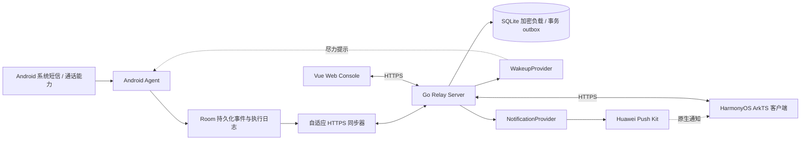
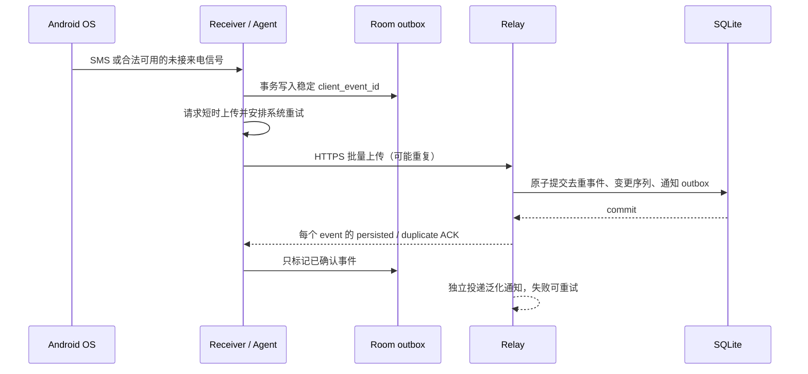
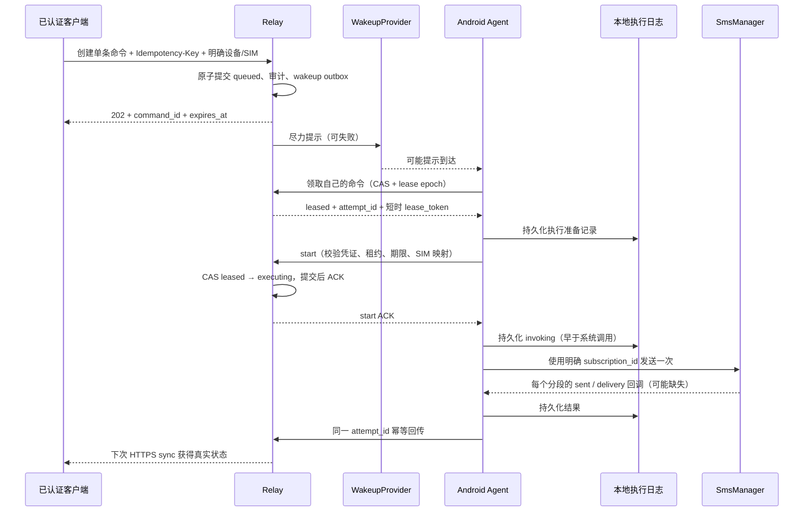

# RFC-0001: OpenALC Relay 系统架构

服务端与 Web 管理面板的分阶段首版实施计划见 [RFC-0002](RFC-0002-server-mvp.md)；其中接口仍为提案，不是已实现契约。

2026-11-03 优先级更新：用户决定先使用 Web 客户端，暂缓 HarmonyOS 原生应用/Push Kit，详见 [ADR-0003](../decisions/0003-web-first.md)。下文保留原始原生方案作为后续参考，不能当作当前必做里程碑。

- 状态：Proposed；按用户要求建立的初始方案，尚未通过实机验证
- 日期：2026-11-02（Asia/Hong_Kong）
- 目标仓库：`OpenALC/relay`；本地初始目录为空，无 Git 历史或可复用代码
- 范围：产品边界、可靠性与安全协议、PoC 决策门槛、最小工程骨架
- 关联：[PoC 计划](../development/POC-PLAN.md)、[平台证据](../development/PLATFORM-VERIFICATION.md)

后续进度：用户已授权 Android 合成数据入站 PoC，范围和验证边界见 [ADR-0002](../decisions/0002-synthetic-sms-poc.md) 与 [PoC 记录](../development/ANDROID-POC.md)。下文的“本轮”指初始化轮，正式业务认证/加密/API 仍未实现。

## 1. 目标、非目标与交付边界

目标是把用户自有 Android 手机及 SIM 的短信、未接来电汇聚到自托管服务器，在 HarmonyOS 原生客户端与 Web Console 中查看，并在用户明确操作后由指定 Android/SIM 发送一条短信。

首版按单人自托管设计，但资源保留 `owner_id`，避免把所有设备凭证当管理员。多租户 SaaS、团队协作、批量营销、通话录音、完整通讯录同步、自动读取/填写 OTP、规避系统权限及后台限制不在范围内。未接来电是条件能力，权限不可用时必须如实禁用。

本轮只交付架构文档、PoC 计划、工程规范、Go 健康检查及迁移基础设施。认证、加密业务存储、短信处理和 UI 尚未实现；不得接入真实敏感数据。正式开发在本轮架构汇报后按小步任务推进。

## 2. 主要决策与取舍

| 决策 | 理由与代价 |
| --- | --- |
| Go 模块化单体 + SQLite | 面向少量个人设备，部署与备份简单；SQLite 阶段仅一个服务进程，本地磁盘 |
| 标准库 HTTP 与结构化日志 | 暂无复杂路由需求，减少框架依赖；后续业务按模块分离 |
| `modernc.org/sqlite` | 无 CGO，便于 Windows 开发和 Linux binary；固定版本并跟踪其匹配的 libc 和第三方许可证 |
| Offline-first、HTTPS 主动同步 | 后台被限制时保留数据；不承诺常驻在线和秒级执行 |
| Push-assisted | 推送只是提示；厂商接入不影响服务端已持久化状态 |
| 保守的短信执行状态机 | 损失部分自动恢复能力，换取不确定窗口内不自动重复发送 |
| 认证加密的应用层负载存储 | 保护磁盘、WAL 和备份内敏感负载；服务器仍可解密，不是端到端加密 |
| 原生 HarmonyOS ArkTS/ArkUI | 不依赖 Android APK 兼容；HarmonyOS 7 的 SDK/build 映射必须实测 |

PostgreSQL 预留为存储适配，不承诺 SQL 文件可直接复用。不引入 Redis、队列服务、常驻 WebSocket 或高频心跳。当前不选择开源许可证：建议评估 Apache-2.0 与 MIT，待仓库所有者确认后添加正式 `LICENSE`，避免代替所有者授予授权。

## 3. 总体架构与模块边界

| 模块 | 责任与禁止事项 |
| --- | --- |
| identity | 用户认证、会话、设备配对与凭证撤销；不与设备 token 混用 |
| devices | Agent/客户端清单、SIM 映射、能力、last_seen；不把推送回执当在线证明 |
| events | 事件验证、加密、去重、查询；不执行远程短信 |
| commands | 用户意图、限速、领取、执行授权、结果归并、过期；不调用厂商 SDK |
| sync | 持久化变更序列、游标、分页、ACK；不靠推送保证完整性 |
| notifications | outbox 调度、唤醒/通知适配、token 更新、有限重试；不修改短信执行结果 |
| audit | 记录 actor、动作、资源 ID、结果、时间；不保存正文或完整号码 |
| storage | SQLite 事务和迁移、未来 PostgreSQL 实现；业务层不依赖特定驱动错误码 |

模块目录在实际功能开发时增加，当前只建立被使用的基础包。API handler 负责协议和鉴权入口；业务服务负责不变量及事务边界。

### 推送接口（设计，不是已完成实现）

`WakeupProvider.Wakeup(ctx, target, hint) -> ProviderAcceptance` 与 `NotificationProvider.Notify(ctx, target, hint)` 分开。target 是已授权设备及 provider token 引用；hint 只有类型、无敏感数据的 opaque ID、过期时间、折叠标识。返回值只表示 provider 接受情况。

没有可用 provider 时状态为 `unavailable`，命令仍然等待 Agent 在前台、系统允许的后台任务或手动同步时拉取。不得实现一个总是成功的 no-op 来伪装接入。厂商通知展示不等于执行代码；不以后台数据消息作原生通知的替代品。

## 4. 通信时序

### 4.1 入站事件

Receiver 先落盘再网络，不持有广播等待长请求。立即尝试只是 best effort；WorkManager 接管后续。落盘与 enqueue 的崩溃间隙通过启动/系统允许的周期任务扫描 outbox 补偿。进程死亡、请求超时、ACK 丢失时重传同一个 ID，禁止重生成 ID。

批次逐条 ACK；永久性校验失败隔离到本地错误队列，不能无限重试，也不能静默删除。服务端同 ID 不同内容返回冲突；payload 比较使用服务端带密钥摘要，不能记录 OTP 的普通散列。队列空间不足时显示健康告警，保留未确认记录，不能宣称无限离线容量。

### 4.2 远程发送

网络创建重试复用 owner 范围的幂等键；相同键不同负载返回 409。业务 ID 与设备执行 attempt ID 分离。一个命令只有一个明确收件人，长短信分段仍属于同一用户意图。配额按潜在分段计数，UI 在执行前提示可能资费。

## 5. 命令状态机与防重边界

| 状态 | 含义 | 允许的后继 |
| --- | --- | --- |
| queued | 已持久化，尚未领取 | leased / expired / cancelled |
| leased | 指定设备领取，有短时租约，未获系统发送授权 | executing / queued / failed / expired / cancelled |
| executing | 服务端已提交 start；短信可能已经交给系统 | sent / failed / unknown |
| sent | 所有分段均有系统发送成功证据；不等于对端送达 | 仅独立 delivery 状态补充 |
| failed | 有明确失败证据；可能包含部分分段成功 | 终态，不自动重发 |
| unknown | 可能已发送，证据不足 | 同一 attempt 的可信迟到结果可细化为 sent / failed |
| expired / cancelled | 执行授权前过期或取消 | 终态 |

关键约束：

1. `claim`、`start` 都用事务/CAS。start 校验 device 未撤销、owner、attempt、lease epoch/token、服务器时间和命令过期时间。
2. Agent **未收到 start ACK 不得调用 SmsManager**。ACK 丢失可以查询/回报同 attempt，但不通过自动重领执行来消除疑惑。
3. 只有从未 start 的 leased 命令才可租约到期回 queued；旧 lease 的 start 必须失败。
4. executing 超时进 unknown，永远不自动回 queued。重启发现 invoking 或无法证明未调用系统的记录，只做结果对账，不发送。
5. 写 invoking 后到调用系统前崩溃也保守视为 unknown。SQLite/Room 与无线网络栈之间没有跨系统原子事务，无法保证 exactly-once。
6. 任意分段已交给系统后，不自动重发整条或未知分段。部分发送单独记录，明确告知用户。
7. 重复结果是幂等更新；互相矛盾的结果返回冲突并留审计。迟到结果必须匹配原 attempt 且有可验证的回调记录，不能由任意新 lease 覆盖。
8. executing 后过期/撤销不能撤回已交给基带的短信。取消请求应返回 too_late，而不是显示“已取消”。
9. 用户看过不确定结果并再次明确确认后，可创建引用原命令的新意图；提示可能重复及资费，绝不后台自动创建替代命令。

## 6. 数据模型（目标设计，尚未建立业务表）

ID 使用随机 UUID；时间使用 UTC RFC3339，可靠性判断以服务器时间为准。事件同时保留 occurred_at 与 received_at，不能按设备时间做去重或唯一排序。

| 实体 | 关键字段与约束 |
| --- | --- |
| owners / user_credentials | 用户身份、凭证、状态；首版一个 owner，保留资源边界 |
| client_sessions | owner_id、客户端类型、凭证摘要、期限、revoked_at |
| devices / device_credentials | owner_id、设备角色、installation_id、凭证摘要、capabilities、last_seen_at、revoked_at |
| pairings | owner_id、挑战摘要、有效期、单次使用标记、批准记录；防爆破 |
| sim_bindings | device_id、server SIM UUID、subscription_id、mapping_version、槽位快照、加密标签；禁止将槽位当长期身份 |
| events | owner_id、device_id、installation_id、client_event_id、类型、SIM UUID、时间、加密 envelope、摘要 |
| commands | owner_id、device_id、SIM UUID/mapping_version、kind、状态、幂等键、expires_at、加密 payload |
| command_attempts / segments | command_id、attempt_id、lease_epoch、lease/token 摘要、start/结果时间、分段 sent/delivery 证据 |
| changes | owner_id、单调 change_seq、资源类型/ID、操作、墓碑；游标不含正文 |
| notification_outbox | 事务内创建的投递意图、provider、目标引用、next_attempt_at、限额和结果 |
| audit_entries | actor_type/id、owner、动作、资源、结果、request_id、时间，不含正文 |

事件唯一键为 `(device_id, installation_id, client_event_id)`，防止双卡/多段短信因正文相同被误合并。设备重装使用新 installation_id，并要求重新配对。命令幂等键为 `(owner_id, idempotency_key)`；数据库与每条查询都强制资源归属。

SQLite 使用 WAL、foreign_keys、busy_timeout、有界事务和单进程写入；文件置于本机持久化磁盘，不能多副本共享 WAL 文件。迁移加版本与校验和，启动失败不开放 readiness；旧二进制遇到未来迁移拒绝启动。首个迁移只建立迁移账本，不创建可能诱导明文存储的业务表。

未来 PostgreSQL 必须重新验证锁、领取 CAS 和游标提交顺序。不能把普通 sequence 分配顺序误当事务提交顺序，否则分页可能永久漏变更。

## 7. API 与同步契约

当前事实契约在 [`packages/openapi/openapi.json`](../../packages/openapi/openapi.json)，仅包含 `/healthz` 与 `/readyz` 的 GET/HEAD 操作。以下为 **Proposed v1**，不是可调用接口：

| API | 身份 | 语义 |
| --- | --- | --- |
| POST /v1/pairings | 用户 | 创建短时配对挑战；批准与设备交换凭证分开 |
| POST /v1/pairings/exchange | 一次性挑战 | 受限交换；用户批准之前不能获得可用设备授权 |
| GET /v1/devices | 用户 | 仅 owner 设备与能力/状态 |
| POST /v1/devices/{id}/revoke | 用户 | 撤销设备凭证、未 start 命令及推送路由 |
| POST /v1/agent/events | Agent | 从凭证推导 device_id，批量入站、逐条 ACK |
| PUT /v1/agent/status | Agent | 电量、网络、权限、SIM 映射、软件版本 |
| POST /v1/agent/commands/claim | Agent | 原子领取自己的未过期命令，不能指定别的设备 |
| POST /v1/agent/commands/{id}/start | Agent | 短时租约换取一次执行授权 |
| PUT /v1/agent/commands/{id}/result | Agent | 同一 attempt 回传分段结果，幂等 |
| POST /v1/commands | 用户/受限原生客户端 | 一个收件人、明确设备/SIM、幂等键；返回 202 而非发送成功 |
| GET /v1/commands/{id} | 用户 | 查询真实命令/分段/delivery 状态 |
| POST /v1/commands/{id}/cancel | 用户 | 仅执行授权前可取消 |
| GET /v1/events | 用户 | device、SIM、类型筛选，稳定 cursor 分页 |
| GET /v1/sync?cursor=… | 用户客户端 | 变更增量、墓碑、next_cursor、has_more |
| PUT /v1/notification-tokens/{id} | 用户客户端 | 注册/轮换 provider token，并校验归属 |

用户和 Agent 使用不同认证中间件与 audience/scope，禁止仅因都是 bearer token 而互通。Web cookie 需要 SameSite、HttpOnly、Secure、Origin/CSRF 防护；原生客户端使用受限且可撤销的独立会话。错误采用 RFC 9457 problem JSON（`type/title/status/code/request_id`），不回显请求正文或凭证。

初步配额提案：事件批次最多 100 条、请求体 256 KiB；单用户远程发送每分钟 5 次及可配置日限额，按设备/用户共同限制，服务器原子记账；精确阈值经 PoC 后确定。429 返回 Retry-After，未知幂等键状态不能当新的发送意图。事件、短信条数与分段上限分别验证。

同步游标为 owner 绑定、不透明的版本化 token；SQLite 在同一写事务里分配并提交 change_seq。客户端只有本地应用成功后推进游标。保留期之外返回明确的 cursor_expired（410），走有一致边界的全量快照再增量，不能默默跳到最新。恢复旧备份时更换同步 epoch，强制重新建立快照。

## 8. Android 后台和双卡策略

官方约束与证据见 [平台验证清单](../development/PLATFORM-VERIFICATION.md)。`goAsync()` 不取消广播执行时间限制；Receiver 只做有界本地采集，不在主线程网络访问。WorkManager 是可延期的持久任务调度，不是秒级 SLA；expedited 有配额。Doze、强制停止、权限撤销和 HyperOS 策略必须分别测试。

| 条件 | 传输建议（需实测调参） |
| --- | --- |
| 新事件且系统窗口允许 | 本地提交后尝试短时 HTTPS，失败保留并 enqueue 唯一同步任务 |
| 前台有待处理命令 | 立即 HTTPS 拉取；必要时短时 WebSocket，离开前台后关闭 |
| 充电 + Wi-Fi | 合并上传与状态同步，系统允许时更积极补传，不常驻 socket |
| 电池/移动网络 | 合并批次、复用网络请求，电量等状态搭车上报 |
| 低电量/省电/Doze | 延后非紧急状态上传；保留事件，不用心跳对抗系统 |
| 无可用推送 | 手动/前台拉取 + 系统允许的低频补偿任务，向用户显示延迟能力 |
| 连续唤醒/同步失败 | full jitter 指数退避，尊重 Retry-After；合并提示、停止无界唤醒 |

周期 WorkManager 仅用于修复性扫描，不能解释为固定每 15 分钟可联网；正常路径事件驱动。重试只针对安全的上传/结果同步，绝不把网络重试策略套在 SmsManager 调用上。前台服务仅在系统允许且用户能感知的任务使用，不为保活随意启动。

接收必须区分 SMS_RECEIVED 与默认短信应用专属的 SMS_DELIVER，按真实权限使用。Android 17 的 OTP 保护可能影响及时获取验证码，不能声称“有 RECEIVE_SMS 就必然即时收到全部短信”；SMS Retriever/User Consent 也不能当作任意短信转发的通用替代。是否有合法适用的角色/伴随设备能力、是否应承担默认短信应用职责，都是 `Needs Verification`，不为绕过限制强行申请角色。

发送使用明确 subscription 的 SmsManager（新 API 优先 createForSubscriptionId），不允许静默回退默认 SIM。subscription_id、槽位、SIM UUID 不是同一个概念；换卡、禁用、eSIM 变更后更新 mapping_version，命令引用旧映射应失败并要求重新选择。不能假设有权读取 ICCID 或本机号码。

未接来电优先评估合法访问 call log 的方式；READ_CALL_LOG 为受限权限，侧载也不保证可授予。电话状态变化不能证明“未接”，拒接/占线/取消必须区分。不默认申请通知读取或无障碍权限作为捷径。

## 9. HarmonyOS 与推送

客户端原生 ArkTS/ArkUI，使用 HarmonyOS 对应 Push Kit 服务端鉴权与应用配置，不复用旧版 Android HMS 接入来假装完成。验证 DevEco Studio、HarmonyOS 7 实际 SDK/API、签名 profile、Push capability、账号类型与应用分发方式。

默认推送为系统可展示的泛化通知，例如“Relay 有新事件”，只携带随机资源引用；正文、OTP、手机号不离开 HTTPS 的授权数据通道。点击通知完成认证后再拉取。通知权限关闭时仍可前台同步，界面明确说明不可提醒。

通知 provider 的接受、云侧回执、系统通知显示、用户已读分别记录，不推断彼此成功。官方后台消息面向延后处理的场景，不保证唤醒执行，更不等于原生通知。Push Token 轮换必须更新，失效 token 停止重试；分类权益、频控、地区与服务账号开通均为前置 gate。目标用户设备/账号所在地未确认，不能从开发机时区推断服务资格。

小米透传服务已停止的公告使“静默推送唤醒 Android 并自动执行”的原方案存在明显可行性风险。只在官方允许且实测可用的机制上接入；通知点击、FCM（有实际可用服务时）、前台同步、系统任务分别报告能力，不伪装成同等即时性。

## 10. 安全模型

### 身份、配对与访问控制

- 公网必须 HTTPS，服务放可信反向代理后；原生客户端拒绝无效证书，不提供跳过验证开关。
- 规划一次性本地管理员 bootstrap，用户认证优先评估成熟 WebAuthn/passkey 库；密码备用方案必须另行选择成熟 Argon2id 实现。认证未实现之前不开业务端点。
- 配对由已认证用户发起，采用至少 256-bit 随机挑战、短时有效、单次交换和明确批准。可读短码只能辅助确认，不能独立兑换长期凭证；短码尝试限速。
- 每台 Agent 与每个原生客户端独立随机凭证，服务端保存摘要和 scope，支持轮换、撤销及有限重叠窗口；不做共享管理员 token。
- 所有 endpoint 校验资源归属，Agent 不能读其他设备事件/命令。撤销使后续 claim/start 失败；离线设备上的已持有数据不能远程保证擦除。
- Web 禁止跨站远程发送，拒绝宽松 CORS；远程发送必须有用户显式操作、限速、幂等和不可省略的审计记录。

### 存储、密钥与隐私

- 业务写入前实现 AES-256-GCM envelope：随机 nonce、key_id、版本、ciphertext/tag；AAD 绑定 owner/device/record/type，防止密文换位。
- 正文、对端手机号、发送负载、SIM 敏感标签、push token 加密；可查询的非敏感元数据和必要时间戳仍可能泄露通信模式，需在安全说明中告知。
- 服务端主密钥通过受限文件或运行环境注入，与数据库备份分开。丢失密钥不能恢复正文；轮换先支持多 key_id 解密再重加密，不覆盖未知 key 的数据。
- Agent 凭证与本地加密密钥用 Android Keystore；Room 本身不等于加密。HarmonyOS 密钥存储用其原生安全能力，具体 API 待验证。
- 同 ID 的 payload 比较、精确号码检索如需支持，使用独立派生密钥的 HMAC；不做正文全文索引或记录 OTP 的无密钥摘要。
- 推送供应商会看到路由 token、时间和泛化通知，不看到短信正文；这是自托管加密存储设计，**不是 E2EE**。
- 日志、错误响应、反向代理访问日志不记录正文、凭证、完整号码和查询串。审计只留元数据，按明确策略清理。

## 11. 错误恢复、备份与运维

| 故障 | 行为 |
| --- | --- |
| Agent 断网/进程回收 | outbox 持久保留；系统允许时重传同 ID；启动扫描补偿漏 enqueue |
| 服务端写入后 ACK 丢失 | 同 ID 重试返回 duplicate ACK，避免重复事件与通知 |
| 服务端提交后推送失败 | 事务 outbox 有界重试，不撤销事件/命令，也不改执行状态 |
| claim 后设备消失 | 从未 start 的租约可释放；start 后只对账、超时 unknown |
| 发送后结果上传失败 | 本地保留分段结果，重复上报同 attempt，不重复调用系统 |
| 数据库满/迁移失败 | 返回不可用或启动失败，不 ACK 未提交数据；Agent 保留 outbox |
| 凭证被撤销 | 停止上传敏感数据与拉取命令，提示重新配对，不无限认证重试 |
| 重装/服务器回滚 | 新安装身份重新配对；还原后暂停远程发送并核对执行记录 |

SQLite 备份用在线备份 API 或停服后的完整一致副本，不只复制活跃 WAL 模式下的主文件。备份加密、限制权限、异地保留，密钥单独备份。恢复演练校验版本/解密/数量、更新 sync epoch；已存在于旧备份的未完成命令全部暂停，禁止恢复后自动发送。自动化备份和恢复工具属于后续开发，当前只提供操作边界。

健康检查区分活性 `/healthz` 与数据库就绪 `/readyz`，响应不泄露 DSN、路径或错误详情。结构化日志包含事件名、受控资源 ID、耗时/结果；future 指标只统计队列大小、失败数、延迟分布。last_seen 是最后同步观测，不声称设备实时在线；显示 recently_seen/stale/unknown 及观测时间。

Docker Compose 与 systemd 为两种独立单实例运行方式。Rocky Linux 9.5 上验证 SELinux 卷标记、服务 UID、文件权限、防火墙、反向代理 TLS、时钟和磁盘空间。当前示例仅本地健康验证，不是完成的生产部署方案。

## 12. 风险与验证决策门槛

| 优先级 | 风险 / Needs Verification | 结果影响 |
| --- | --- | --- |
| P0 | Android 17 OTP 延迟及两台目标手机实际系统版本/角色能力 | 若普通应用无法及时获取，明确产品能力边界，不承诺验证码实时转发 |
| P0 | 小米无透传后是否存在适合本用途的合法自动唤醒路径 | 不可用则命令排队、用户主动同步，不能宣传后台秒级发送 |
| P0 | start/系统调用/回调间崩溃、多段部分成功 | 必须证明不自动重复发送；可接受 unknown，不能“测试失败重试发送” |
| P0 | HarmonyOS 7 Push Kit 的原生接入、签名、权益、地区/账号/分发资格 | 原生通知不通过则不得宣称已支持，先补证据或调整里程碑 |
| P1 | HyperOS 锁屏、Doze、回收、强制停止、重启、首次解锁 | 用分状态支持矩阵替代笼统“后台可靠” |
| P1 | READ_CALL_LOG、SEND_SMS、双卡映射权限/安装限制 | 能力降级和失败提示；不绕过系统 |
| P1 | SQLite、加密密钥、磁盘满、备份回滚 | 必须验证 ACK 原子性与恢复后禁止重放命令 |
| P2 | 自适应策略耗电/延迟、批次与频率 | 按实测调参，不把实验目标写成保证 |

下一阶段依照 PoC 先验证入站离线队列与手机权限，再验证唤醒与远程发送安全窗口，随后验证原生 HarmonyOS 通知及耗电。任何真实短信发送、厂商账号注册或外部费用都需对应的用户明确授权。
